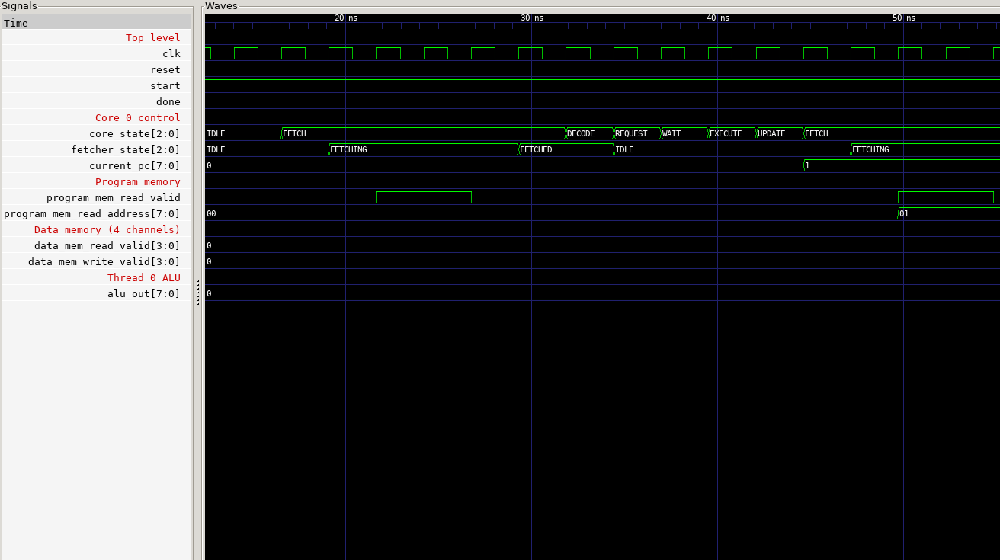

# Tiny GPU — Progress Report

**CS 220: Synthesis of Digital Systems**
Jordan Ayvazian · Shane Zimmerman · Svetlana Nosova
Repository: https://github.com/jorbo/tiny-gpu/tree/master

---

## 1. Baseline Design Recap

**tiny-gpu:** a minimal SIMD GPU in SystemVerilog (12 modules, ~1,300 lines in `src/`)

- **Top level:** dispatcher → 2 compute cores → program and data memory controllers
- **Each core:** scheduler, fetcher, decoder, plus per-thread ALU, LSU, PC and register file (4 threads per block)
- **Control:** a multi-cycle scheduler FSM per instruction: FETCH → DECODE → REQUEST → WAIT → EXECUTE → UPDATE
- **ALU:** ADD / SUB / MUL / DIV, all single-cycle (8-bit combinational divider)
- **Kernels:** matrix addition (1×8, 8 threads) and matrix multiplication (2×2, 4 threads)

> Proposal goal: Control-FSM cycle reduction (A1 bypass WAIT, A2 merge DECODE+REQUEST, A3 fuse EXECUTE+UPDATE)

---

## 2. Methodology: Verification & Testing

**Functional verification: two independent testbenches**
- **cocotb** (Python): the original matadd / matmul tests, ported to cocotb 2.x
- **Plain Verilog testbench** (`test/tb_gpu.v`): same kernels and memory model, with no Python dependency
  - Clock period set at compile time to match each synthesis run
  - Checks results against expected values and reports the cycle count
  - Dumps a VCD for waveform inspection and power analysis

**Simulation levels**
- **RTL:** SystemVerilog → `sv2v` → Icarus Verilog
- **Gate level:** synthesized netlist + SAED32 LVT/HVT cell models (zero-delay)
  - Mux models patched for X-pessimism (`test/saed_xfix.awk`), see Challenges
  - Confirms the netlist matches RTL behavior cycle for cycle

---

## 2. Methodology: Synthesis & Power Flow

**Library:** SAED32 at the **worst-case corner, SS 0.75 V / 125 °C** (`saed32{rvt,lvt,hvt}_ss0p75v125c.db`),
for synthesis and PrimeTime alike

**Design Compiler** (`syn/dc_synth.tcl`)
- `compile_ultra -gate_clock` keeping the module hierarchy, for per-module PPA
- **Automatic clock gating:** integrated clock-gating cells in front of flop banks that load under an enable
- **LVT + HVT only:** LVT on critical paths, HVT elsewhere for low leakage; RVT cells banned
- Constraints: ideal clock with 0.1 ns uncertainty; I/O delays of 20% of the period
- Post-compile clean-up loop: setup recovery, hold fixing, and driver upsizing for small DRC violations

**Max-frequency search** (`syn/sweep.sh`)
- Searches clock periods for the shortest that passes
- **Pass = setup slack ≥ 0, no hold violations, no DRC violations**
- Runs up to 3 DC jobs in parallel

**PrimeTime** (`syn/pt_eco.tcl`, `syn/pt_power.tcl`)
- Independent setup/hold check at the chosen period
- Signoff DRC ECO: upsize or buffer drivers PT flags, keeping each change only if setup and hold stay met
- Averaged power from a **gate-level VCD** of each kernel at that same period

---

## 2. Methodology: Memory Model

**Today:** program and data memory are testbench models outside the synthesized GPU
- Program memory 256 × 16 bit (512 B) and data memory 256 × 8 bit (256 B)
- **1-cycle latency, always ready:** a request seen at one clock edge is answered at the next
- **Data memory answers all 4 channels in the same cycle**, which makes it a 4-port memory
- Memory area and power are **not** in our PPA numbers
- Even with ideal memory, an instruction fetch takes ≈6 cycles (controller + fetcher handshake)

**Why it matters for A1–A3:** cycle counts, and the savings we claim, depend on memory latency and contention

**Plan: model it as on-chip SRAM** from the SAED32 memory kit (768 B in total, far too small for DRAM)

| SAED32 source | Cycle time | Access time | At our 2.90 ns clock |
|---|---|---|---|
| Datasheet, per-macro table (`SRAM1RW256x8`) | 6 ns | 3 ns | +1 wait cycle on reads, one access every 3 cycles |
| Datasheet, general spec ("500 MHz") | 3 ns | 2 ns | no extra wait, one access every 2 cycles |
| Liberty `.db` (PrimeTime-measured) | n/a | 0.04 ns | placeholder arcs, so not usable for timing |

- **Today's model is an ideal synchronous SRAM**: latch on one edge, data by the next. What it misses is
  **busy time** (a macro can't take back-to-back accesses) and **a single port** (it serves all 4 channels at once)
- Model to add to the testbench: wait cycles (0–1), busy cycles (2–3), one port per macro;
  data memory as 1 × 256×8, or 4 × 64×8 banks so channels can overlap
- **Area:** data memory 8,633 µm², program memory 2 × 8,633 µm² (no 256×16 macro);
  25,899 µm² in total, **+56% on 46,633 µm² of logic**
- **Power:** the library has no leakage data; the datasheet's 2.5 mA standby (≈2.6 mW per macro) is reported as an estimate only
- Sweep the model across that range to show how sensitive cycle counts and A1–A3 savings are

---

## 3. Verification Results

| Test | RTL (cocotb) | RTL (Verilog TB) | Gate-level, SS netlist @ 2.90 ns |
|---|---|---|---|
| Matrix add (8 threads, both cores) | PASS | PASS — 178 cycles | **PASS — 178 cycles** |
| Matrix mul (4 threads, core 0 only) | PASS | PASS — 491 cycles | **PASS — 491 cycles** |

- The gate-level netlist matches RTL cycle for cycle on both kernels
- Waveforms: VCDs from both RTL and gate-level runs (`make tb_matmul`, `make gls`)
- Kernel latency at the final clock: **matmul 1.42 µs**, **matadd 0.52 µs**

---

## 3. Verification Results: Waveform

First instruction, `MUL R0, %blockIdx, %blockDim`, at a 2.55 ns clock:
- **FETCH ≈ 6 cycles:** program memory round trip (fetcher FETCHING → FETCHED)
- **DECODE → REQUEST → WAIT → EXECUTE → UPDATE:** 1 cycle each, about **11 cycles per instruction**
- **WAIT costs a cycle even though MUL makes no memory access**, which is the target of A1
- PC goes 0 → 1 and the next fetch starts at program address `01`

---

## 3. Synthesis Results: Frequency Closure

| Step | Corner | Period | Frequency | Cell area (µm²) |
|---|---|---|---|---|
| Starting point: RVT, unconstrained push | TT 0.78 V 25 °C | 10.0 ns | 100 MHz | 35,257 (2.64 ns slack left) |
| Exploration: LVT + HVT, clock-gated | TT 0.78 V 25 °C | 2.55 ns | 392.2 MHz | 42,975 |
| **Final: LVT + HVT, clock-gated, swept** | **SS 0.75 V 125 °C** | **2.90 ns** | **344.8 MHz** | **46,633** |

- Sweep at SS: 2.90 ns passes, **2.85 ns fails** (one DRC net on the `reset` fanout)
- The worst-case corner costs **14% in frequency and 8% in area** against TT
- Final netlist: 11,563 LVT / 3,835 HVT cells, 0 RVT, 211 clock-gating cells (`CGLPPRX2_LVT`)
- **Critical path slack (PrimeTime): +0.035 ns** setup, +0.00001 ns hold. The worst paths run from the
  LSU write-valid flags into the data memory controller's write-data registers

---

## 3. Results: Baseline PPA & Cycles (what A1–A3 are measured against)

**Corner:** SS 0.75 V 125 °C · **Performance:** 344.8 MHz (2.90 ns) · **Area:** 46,633 µm² cells ·
**Timing (PrimeTime):** setup WNS +0.035 ns, hold WNS +0.00001 ns

| Per kernel | Matmul (2×2, core 0) | Matadd (1×8, both cores) |
|---|---|---|
| Instructions per thread block | 41 (5 LDR/STR) | 13 (3 LDR/STR) |
| **Cycles** | **491** | **178** |
| Cycles per instruction | ≈12.0 | ≈13.7 |
| Latency | 1.42 µs | 0.52 µs |
| Power: dynamic / leakage | 1.03 / 4.22 mW | 1.20 / 4.27 mW |
| **Total power** | **5.26 mW** | **5.48 mW** |
| **Energy per kernel** | **≈7.5 nJ** | **≈2.8 nJ** |

PrimeTime averaged power from gate-level VCDs (100% of nets annotated)

---

## 3. Results: Where the Power Goes

| Module | Matmul | Matadd |
|---|---|---|
| Core 0 | 1.66 mW (32%) | 1.66 mW (30%) |
| Core 1 | 1.68 mW (32%) **idle** | 1.85 mW (34%) |
| Data memory controller | 0.83 mW (16%) | 0.87 mW (16%) |
| Dispatcher, program memory controller, rest | 1.09 mW (21%) | 1.10 mW (20%) |
| **Total** | **5.26 mW** | **5.48 mW** |

- **Leakage is 78–80% of power**: it is paid every cycle whether or not logic switches
- So **energy ≈ power × cycles × 2.90 ns, and power barely moves** (5.26 vs 5.48 mW):
  cutting cycles cuts energy almost one for one, which is what A1–A3 target
- Clock gating already removed most idle switching: the clock network is 1.04 mW (20%) in matmul, 1.14 mW (21%) in matadd
- Core 1 does no work in matmul but still costs 1.68 mW, 91% of it leakage (more than busy core 0:
  it was synthesized with more LVT cells)

---

## 4. Challenges & Solutions (1/2)

| Challenge | Solution |
|---|---|
| Synthesis server has no `sv2v`, cocotb or simulator | Generate `gpu.v` and VCDs locally and track them in git; scope the cocotb Makefile variables to test targets only |
| Sweep failed on **tiny DRC misses** (max_transition missed by 0.0001–0.01 ns) on high-fanout nets | Post-compile pass that upsizes each violating driver (X0→X1→…, then HVT→LVT) |
| DC stops at WNS ≈ 0 and often lands 0.01 ns short, so pass/fail was **non-monotonic** | **3% setup over-constraint** during optimization only; real constraints restored for reports and signoff |
| LVT cells made short paths too fast, so **hold violations** appeared | Dedicated hold-fix pass as the final step, alternating with DRC fixes |
| Each DC run takes 5–10 min | Parallel sweep rounds (3 DC jobs per round) |

---

## 4. Challenges & Solutions (2/2)

| Challenge | Solution |
|---|---|
| RTL VCD annotated only **4.7%** of nets in PrimeTime (renamed generate blocks; arrays not dumped) | Gate-level simulation of the netlist: **99.99%** annotated |
| Gate-level sim (TT) **hung** with X values | Testbench held reset for only one edge, and cores reset a cycle later via dispatch; now held for 4 edges |
| DC-written SPEF made PrimeTime timing **0.17 ns worse** than DC | PrimeTime's own per-hierarchy wire-load models match DC; SPEF made opt-in |
| Clock gating: SAED32 gating cells have a test-enable pin, so DC rejected them by name (PWR-192) and silently fell back to RVT ones | Default gating style, then swap each gating cell to LVT after compile (same pins, test-enable tied to 0) |
| Hold buffers and DRC upsizing at the end pushed gated paths **0.08 ns** over setup | Final clean-up loop now re-checks setup and runs an incremental setup pass before hold and DRC fixes |
| PrimeTime flagged **172 max_capacitance pins** that DC reported clean (same net caps and limits in both tools) | Timing-aware ECO in PrimeTime: upsize the driver or buffer its loads, undo any change that breaks setup/hold. **172 → 0 pins** with setup and hold still met |
| First flow used the typical corner (TT 0.78 V 25 °C); the project requires worst case | Corner is now a script variable, default SS 0.75 V 125 °C, used by DC and PrimeTime; full sweep rerun |
| SS netlist **stuck at X after reset** in gate-level sim | SAED32 mux models output X on an X select even when both data inputs agree (silicon gives the value). The scheduler's state flop feeds its own next-state mux select. Patched the mux truth tables for GLS only; RTL and netlist then match |

---

## 5. Next Steps: Original Optimization Goals

*[Team decision: continue with A1–A3 or pivot]*

**If we continue with Control-FSM cycle reduction (A1–A3):**

| Change | Cycles saved (estimate) | Matmul | Matadd |
|---|---|---|---|
| A1: skip WAIT on non-memory instructions | 1 per non-memory instruction | ≈36 (7%) | ≈10 (6%) |
| A2: merge DECODE + REQUEST | 1 per instruction | ≈41 (8%) | ≈13 (7%) |
| **A1 + A2** | | **≈77 → ≈414 cycles (−16%)** | **≈23 → ≈155 cycles (−13%)** |

- With power nearly fixed, energy falls about as much as cycles: matmul ≈7.5 → ≈6.3 nJ
- A3 (fuse EXECUTE + UPDATE) lengthens the ALU path (single-cycle 8-bit divider); with no
  only 0.035 ns of margin at 2.90 ns it may cost clock frequency, so it must win more in cycles than it loses in period
- FETCH (≈6 cycles of program-memory latency per instruction) is the largest share and is not addressed by A1–A3
- Same flow for each change: sweep for maximum frequency → gate-level sim (cycles) → PrimeTime → PPA and energy per kernel

**Possible extension suggested by the power results:** leakage is 78–80% of power
- Push more of the non-critical logic to HVT
- Gate or power down the idle core (core 1 costs 1.68 mW during matmul)

---

## Thank You & Questions

Jordan Ayvazian · Shane Zimmerman · Svetlana Nosova
https://github.com/jorbo/tiny-gpu/tree/master

*Full results, scripts and reports are in the repository and the written report.*
